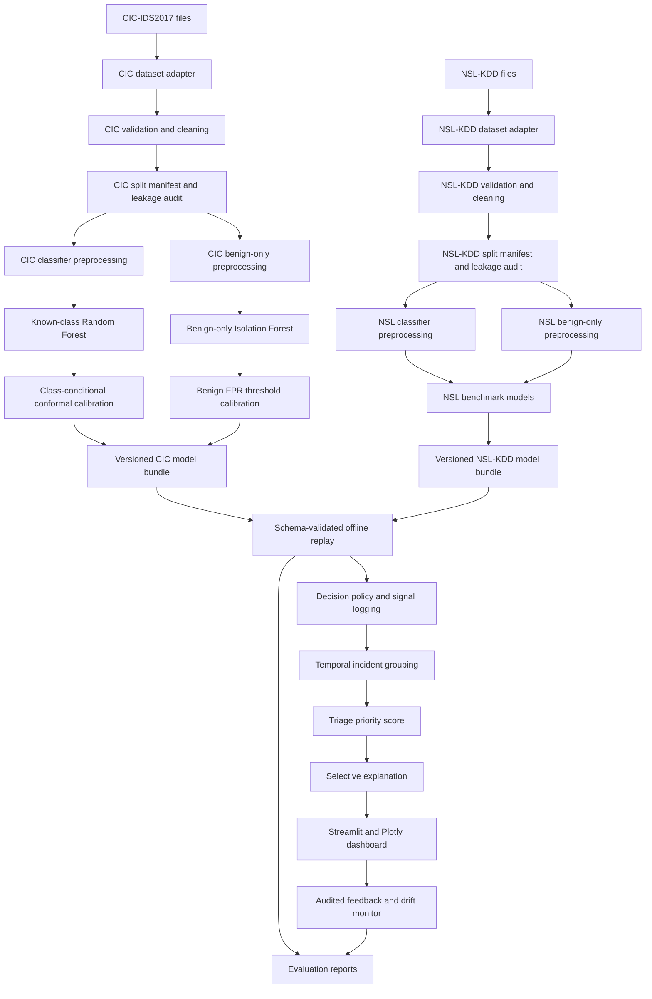

# System Architecture

## 1. Project Summary

**Project:** Leakage-Audited Open-World Hybrid Intrusion Detection System

**Goal:** Detect attack categories represented during training, flag traffic that differs from learned benign behaviour, avoid forcing uncertain traffic into a known class, and provide an auditable explanation for analyst review.

**Problem:** A closed-set classifier must choose among labels it knows and can therefore mislabel unfamiliar traffic. A standalone anomaly detector can also raise too many false alarms. The project combines supervised classification, benign-only novelty detection, conformal uncertainty, and explicit decision rules.

**Demonstration scope:** Offline defensive research using CIC-IDS2017 as the primary dataset and NSL-KDD as a separate secondary benchmark. The system replays labelled public-dataset records; it is not a live network sensor and does not prove real-world zero-day detection.

## 2. Non-Negotiable Design Rules

1. Keep CIC-IDS2017 and NSL-KDD in separate data, preprocessing, model, calibration, and artifact paths.
2. Keep labels and evaluation-only fields outside the inference feature matrix.
3. Fit every learned transformation on its permitted training partition only.
4. Keep the final test data untouched until all models, thresholds, and decision policies are frozen.
5. Keep anomaly-threshold calibration and conformal calibration in disjoint record partitions.
6. Hold a selected attack family out of supervised training and conformal calibration for each LOFO experiment.
7. Never turn a missing, invalid, or failed model output into a benign verdict.
8. Treat an anomaly score as evidence of unusual behaviour, not proof of malicious activity.
9. Keep individual flow alerts visible; temporal correlation may group or escalate them but must not silently suppress them.
10. Do not automatically retrain or recalibrate from unverified analyst feedback.
11. Clearly label all replayed records as dataset-based offline simulation.

## 3. High-Level Architecture



The CIC and NSL-KDD branches share code interfaces, not fitted preprocessing objects or model weights. A cross-dataset transfer experiment is out of scope for the first release.

## 4. Dataset Architecture and Boundaries

### 4.1 CIC-IDS2017 — primary path

Use selected CIC-IDS2017 labelled flow CSV files for the complete open-world experiment.

**Dataset adapter responsibilities**

- Load each selected file separately and record its file name, row count, checksum, and source row number.
- Normalize column names and labels using explicit mappings.
- Validate required columns and compare schemas before concatenation.
- Convert numeric columns safely; record missing, infinite, and failed conversions.
- Preserve source IP, destination IP, ports, timestamp, Flow ID, and source-file details in a metadata/evaluation table as appropriate.
- Exclude Flow ID, source/destination IP, timestamps, row numbers, source filename, labels, and other identifiers from model inputs.
- Treat Destination Port as an explicit experiment: run the primary feature set and a separately named no-port ablation.

**Split and leakage safeguards**

- Define the held-out attack family before model development.
- Keep that family out of supervised training, validation, and conformal calibration for that LOFO run.
- Keep a separate benign-only anomaly-calibration partition.
- Prefer capture-session/source-file-aware and, where feasible, time-aware grouping. Record the exact split groups and the day/family composition; CIC attack families can be tied to collection sessions, so do not claim temporal generalization unless the split actually tests it.
- Audit exact duplicates, conflicting labels, and identical model-feature vectors across partitions. Do not silently discard conflicting-label rows. Where identical feature vectors cross partitions, group them into one split if feasible; otherwise report the overlap and provide a strict de-duplicated sensitivity result.

### 4.2 NSL-KDD — secondary benchmark

NSL-KDD uses a different connection-level schema and must have a dedicated loader and pipeline.

- Load the official training and test files using the documented column order.
- Retain the original attack label and document binary and multiclass/family mappings.
- Exclude the target label and the difficulty field from model features.
- Encode protocol type, service, and flag using train-fitted categorical handling; unseen categories must be handled explicitly.
- Preserve the official test partition. Derive validation, anomaly calibration, and conformal calibration only from the official training portion.
- Report NSL-KDD results independently. Do not concatenate raw rows or reuse CIC preprocessing/model artifacts.

A shared-feature transfer study is optional future work and must specify a measurement-level mapping. Similar column names alone do not establish equivalent features.

## 5. Data Partition Contract

For each dataset and experiment, create five non-overlapping partitions:

| Partition | Permitted use | Restrictions |
|---|---|---|
| `train` | Fit supervised model and permitted preprocessing; fit Isolation Forest on benign rows only | No validation, calibration, or test rows |
| `validation` | Select model settings, feature variants, priority-score weights, and operational bands | Never use as final test or calibration data |
| `anom_cal` | Benign-only anomaly threshold and anomaly-score reference quantiles | No model fitting; disjoint from `conf_cal` |
| `conf_cal` | Class-conditional conformal quantiles for known classes | No model fitting; exclude LOFO-held-out attack families |
| `test` | One-time final evaluation and dashboard replay | Do not tune models, features, thresholds, or rules from results |

The two calibration partitions must contain different record IDs. A record may not be used to set both the anomaly threshold and conformal quantiles in the same experiment. The LOFO-held-out family is present only in the final test path. Keep a machine-readable split manifest containing row IDs, group IDs, labels, and the split method.

### Required split policies

- **CIC-IDS2017:** Prefer capture-group-aware splits; audit source-file/day overlap, class support, and duplicate feature-vector overlap. If a fully time-separated split is infeasible, state exactly which groups overlap and limit the generalization claim.
- **NSL-KDD:** Preserve the official train/test boundary. Split the official training portion into train, validation, `anom_cal`, and `conf_cal` using a reproducible seed and documented stratification/grouping policy.
- **LOFO:** Repeat the experiment for each selected held-out family when data volume permits. The held-out family must be absent from train, validation, and `conf_cal`; it must not influence model selection or calibration. Keep the original family label for evaluation only.

## 6. Model and Calibration Components

### 6.1 Known-class classifier

**Baseline:** `RandomForestClassifier` with class weighting. This is a standard class-weighted Random Forest, not the separate imbalanced-learn `BalancedRandomForestClassifier`.

- Train only on `train` records from the known label set.
- Output a class probability/score vector and predicted class.
- Persist exact class order and verify it at inference.
- Evaluate macro-F1, balanced accuracy, per-class precision/recall/F1, and confusion matrix. Do not rely on accuracy alone.
- Optional XGBoost is a later comparison, not a dependency for the first complete release.

A classifier prediction is closed-set evidence only. It must not be treated as proof that traffic belongs to a known class.

### 6.2 Benign-only novelty gate

**Model:** `IsolationForest`, fitted only on benign records from `train`.

- Use a dedicated novelty preprocessing path. Fit numeric imputation/scaling statistics on benign training records only. For categorical fields, reserve an explicit unknown-category bucket so attack-only or unseen categories are not silently represented as an ordinary benign category.
- At inference, convert the scikit-learn score to one documented convention: larger application-level values always mean more anomalous. For example, negate `decision_function` and test the direction with controlled examples.
- Use the continuous score (`decision_function` or `score_samples`) and the separately calibrated application threshold. Do not use `IsolationForest.predict()` or its `contamination`-derived label cutoff as the deployed FPR policy.
- Save the score transformation and threshold with the model bundle.
- Set the threshold from `anom_cal` using a documented finite-sample order-statistic rule for the target benign false-positive budget, such as 1%.

The target FPR is an operating target on exchangeable calibration data, not a guarantee under distribution shift or temporally dependent traffic. Report test FPR and its uncertainty separately.

### 6.3 Class-conditional split conformal layer

Purpose: show which known labels remain plausible rather than presenting every classifier output as certain.

- Train the classifier on `train`.
- Calculate nonconformity `s(x,y) = 1 - p(y|x)` on `conf_cal` records whose labels belong to the known class set.
- For each known class `c`, compute its own finite-sample quantile using `k = ceil((n_c + 1) * (1 - alpha))` and the `k`-th sorted score.
- If `k > n_c`, the finite-sample fallback is to include that class for every record (equivalent to a threshold of 1 for scores in [0,1]); record the class sample count and fallback status. Do not silently claim a useful class-specific calibration result when the class has too few records.
- At inference, include class `c` when `1 - p(c|x) <= q_c`.

The conformal set is an uncertainty set over known labels. It is not a zero-day detector. State the exchangeability assumptions and report per-class calibration counts and observed test coverage. Duplicates, session dependence, and drift can weaken the assumptions.

### 6.4 Decision policy — authoritative truth table

The verdict must be generated by a deterministic policy, not by whichever model runs last. Preserve all raw signals in every output.

| Novelty gate | Conformal set | Verdict | Required handling |
|---|---|---|---|
| Not triggered | Exactly one known attack class | `KNOWN_ATTACK` | Show the candidate class and classifier signals |
| Triggered | Exactly one known attack class | `KNOWN_ATTACK` with `novelty_conflict=true` | Keep the known candidate, retain the novelty warning, and require analyst review/escalation; do not hide the conflict |
| Not triggered | Exactly `{BENIGN}` | `NORMAL` | Normal candidate only when both required models and schema checks succeeded |
| Triggered | Exactly `{BENIGN}` | `UNKNOWN_ANOMALY` | Unusual traffic; possible unseen attack, not a confirmed zero-day |
| Triggered | Empty or multiple classes | `UNKNOWN_ANOMALY` | Preserve the conformal set and novelty score; analyst review |
| Not triggered | Empty or multiple classes | `UNCERTAIN_REVIEW` | Do not force a class or convert to normal |
| Any | Missing/invalid model output, schema mismatch, or preprocessing failure | `PROCESSING_ERROR` / `DEGRADED_REVIEW` | Never issue a normal verdict; preserve error details and available signals |

A singleton attack-class set remains a known-attack candidate even when novelty is triggered, but the conflict is mandatory visible metadata. For a held-out attack family that happens to resemble a known class, report both the emitted verdict and the independent novelty-gate result; do not claim that the system identified its true unseen family.

**Fail-safe behaviour**

- If the classifier is unavailable, a non-triggered novelty gate is insufficient to declare normal; return `DEGRADED_REVIEW`.
- If the novelty gate is unavailable, a singleton benign conformal set is insufficient to declare normal; return `DEGRADED_REVIEW`.
- If a required input feature is absent, reordered, or has an incompatible type, reject the record or route it to review; never silently fill schema errors with zero.

## 7. Temporal Correlation

Temporal correlation groups related offline replay events; it does not replace per-flow classification.

- Use event timestamps only when the dataset supplies usable timestamps with a known interpretation. Normalize to a common time basis only when the source timezone is known.
- Process records in event-time order. Define a policy for late/out-of-order records and duplicate timestamps.
- Use a rolling 30-second window as a configurable starting value, keyed by dataset/run and available source-host metadata. Reset state at capture-session/day boundaries so unrelated sessions are not joined.
- Group by source host where available. Destination subnet/service can be secondary context, not a substitute for reliable source identity.
- NSL-KDD does not provide the same IP/timestamp metadata as CIC-IDS2017; disable unsupported grouping rather than inventing identifiers.
- Retain every original flow alert. Correlation may create an incident group or raise triage priority, but must not suppress a single-flow alert.
- Validate the correlation rule against known and held-out attacks. A rule such as three suspicious flows in 30 seconds is only a configurable demonstration heuristic, not a universal security threshold.

## 8. Triage Priority Score

The numeric score is a **triage-priority heuristic**, not a calibrated probability of maliciousness, business impact, or attack severity.

A provisional form is:

\[
Priority(x)=100\times clamp(w_1 S_{cls}+w_2 S_{anom}+w_3 H_{norm}+w_4 C_{burst},0,1)
\]

where:

- `S_cls`: non-benign classifier score; call it a probability only if probability calibration has been evaluated and documented.
- `S_anom`: anomaly score mapped through the empirical CDF of benign `anom_cal` scores (with a documented tie rule), then clipped to [0,1].
- `H_norm`: normalized predictive entropy; this measures uncertainty, not maliciousness.
- `C_burst`: bounded temporal burst score.
- The initial weights `0.45, 0.30, 0.10, 0.15` are placeholders, not evidence-based constants. Tune or retain them using validation data only, then freeze them before test.

All inputs must be finite and in [0,1], and larger values must have the intended direction. Store the normalization parameters, weights, and policy version. If a component is unavailable, do not silently replace it with zero; mark the score as partial/unavailable or use a separately versioned fallback. Verdicts are determined by the decision table, never by this weighted score. Display verdict and triage priority separately. Priority bands such as Low/Medium/High/Critical must be selected on validation data and described as operational display bands, not ground-truth severity.

## 9. Explainability

- Use SHAP `TreeExplainer` for supported supervised tree models on flagged or selected records.
- For multiclass output, explain the actual predicted/candidate class and verify the SHAP output shape for the installed SHAP version.
- Show top contributing features, their observed values, and the contribution direction.
- Compare values with benign training reference statistics, such as median and 95th percentile.
- Explain the novelty gate separately using validated feature-attribution support; otherwise show baseline deviations and label them as deviations, not SHAP.
- A feature contribution or baseline deviation is not causal proof.
- Provide defensive investigation hints as suggestions for a human analyst, not automated remediation.
- Record explanation latency separately from inference latency.

## 10. Drift Monitoring and Feedback

- Build fixed bins from the training baseline and store them in the artifact bundle.
- Calculate PSI per selected feature on replay batches with configurable minimum batch size.
- Use a documented smoothing constant for empty bins and report the batch size, missing rate, and features included.
- Suggested interpretation: PSI below 0.10 stable; 0.10–0.25 moderate shift; 0.25 or above significant shift. These are heuristics, not universal detection thresholds.
- PSI indicates distribution change, not malicious activity. Do not use it alone to change verdicts or retrain.
- Store feedback in a separate append-only audit log with alert ID, model version, timestamp, reviewer action, and optional note. Do not treat unverified feedback as ground truth.
- Recalibration or retraining requires a reviewed dataset, fresh split manifest, evaluation, and explicit artifact promotion.

## 11. Application Architecture

### Streamlit dashboard

**Tab 1 — Operations Monitor**

- Start, pause, resume, and reset offline CSV replay.
- Configure replay speed and batch size.
- Display the dataset, experiment/run ID, and an explicit `OFFLINE DATASET REPLAY` label.
- Show total flows, normal candidates, known attacks, unknown anomalies, uncertain/degraded records, and correlated incident groups.
- Plot anomaly scores against the saved calibration threshold and show drift status.

**Tab 2 — Alert Triage**

- Sort/filter by verdict, novelty flag, triage priority, timestamp, and source metadata.
- Show the conformal set, classifier scores, anomaly score/threshold, schema/model status, and correlation context.
- Display SHAP or baseline-deviation explanations with the method clearly labelled.
- Record verified-benign, suspected-attack, or needs-more-investigation feedback without changing model state.

**Tab 3 — Research Proof**

- Show known-class metrics, benign FPR, held-out-family novelty recall, review rate, and confusion matrices.
- Show LOFO results per held-out family.
- Show with-port/no-port and random/group-aware split comparisons.
- Show raw flow alerts and grouped incidents separately; do not call grouping a false-positive reduction unless measured against labels.
- Show throughput, model inference latency, explanation latency, and memory use with hardware and batch details.
- Show CIC-IDS2017 and NSL-KDD results in separate sections/tables.

### Optional FastAPI service

Add FastAPI only after the offline inference function and output contract are stable. Validate dataset ID, schema, feature order, data types, and model-bundle version. Do not expose a public production endpoint in the first release.

## 12. Model Artifact Contract

Keep an independent bundle per dataset, feature experiment, and model run:

```text
artifacts/
  cic_ids2017/
    <experiment_id>/
      classifier_preprocessor.joblib
      novelty_preprocessor.joblib
      supervised_model.joblib
      isolation_forest.joblib
      calibration.json
      feature_schema.json
      split_manifest.json
      metrics.json
      run_manifest.json
  nsl_kdd/
    <experiment_id>/
      classifier_preprocessor.joblib
      novelty_preprocessor.joblib
      supervised_model.joblib
      isolation_forest.joblib
      calibration.json
      feature_schema.json
      split_manifest.json
      metrics.json
      run_manifest.json
```

Every bundle must record dataset source/version and file hashes, feature names/order/types, excluded metadata columns, label mapping and class order, split IDs/group policy, preprocessing configuration, model parameters, random seeds, calibration counts/alpha/FPR target/quantile convention, thresholds and score directions, priority-score policy, metrics, code commit, and dependency versions.

- Validate exact dataset ID, schema, feature names/order, class order, and artifact version before inference.
- Write artifacts atomically and keep a checksum/manifest.
- Load only locally generated, trusted Joblib artifacts. Never accept an uploaded model pickle from an untrusted user because deserialization can execute code.
- Do not put NaN or Infinity in strict JSON manifests; represent unavailable values explicitly as `null` with a status field.

## 13. Security, Privacy, and Scope

- Use public datasets and offline replay only.
- Do not connect the demonstrator to production enterprise/payment networks.
- Do not execute payloads, generate attacks, or perform offensive scanning.
- Limit upload size and file types; validate CSV schema and reject path-like filenames.
- Treat IP addresses and flow metadata as potentially sensitive; keep them local, avoid unnecessary exports, and mask them in screenshots/reports where appropriate.
- Sanitize values before exporting to CSV or displaying them in HTML to avoid formula/script injection.
- Present defensive recommendations as suggestions for a human operator.
- Keep raw datasets unchanged and protect generated artifacts and feedback logs.

## 14. Acceptance Criteria

The architecture is implemented only when:

- [ ] CIC-IDS2017 and NSL-KDD use independent validated loaders and artifact bundles.
- [ ] Raw files are unchanged and provenance/checksums are recorded.
- [ ] Labels, IDs, timestamps, source filenames, and NSL-KDD difficulty are excluded from model features.
- [ ] Duplicate and conflicting-label audits are complete; split overlap is reported.
- [ ] Train, validation, anomaly calibration, conformal calibration, and test are disjoint and manifested.
- [ ] LOFO-held-out families are absent from train, validation, and conformal calibration.
- [ ] The supervised classifier uses known training labels only.
- [ ] Isolation Forest is fitted only on benign training rows.
- [ ] The anomaly score direction and finite-sample threshold rule are tested.
- [ ] Conformal quantiles use the finite-sample rule and report per-class sample counts/fallbacks.
- [ ] Decision fusion has unit tests for every row of the truth table and fail-safe condition.
- [ ] A missing model output or schema mismatch can never produce `NORMAL`.
- [ ] Temporal correlation never removes individual alerts and handles missing metadata safely.
- [ ] Priority score is labelled heuristic and never overrides the verdict.
- [ ] Explanations are labelled according to the method actually used.
- [ ] Drift warnings do not automatically retrain or recalibrate the system.
- [ ] CIC and NSL-KDD results are reported separately.
- [ ] The UI clearly labels all traffic as offline dataset replay.
