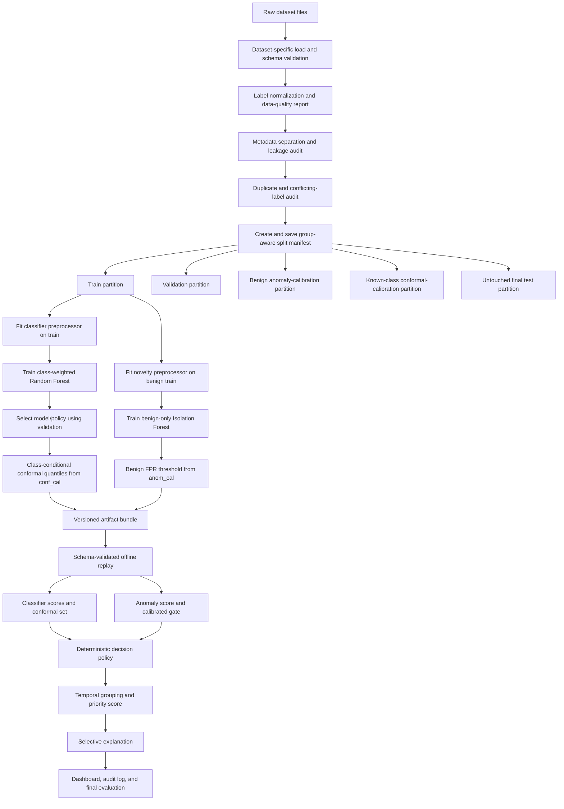

# Detection and Evaluation Pipeline

## 1. Purpose and Scope

This document defines the reproducible path from raw dataset rows to model verdicts, dashboard alerts, and final research metrics.

- **CIC-IDS2017:** primary open-world development and demonstration path.
- **NSL-KDD:** separate secondary benchmark with its own schema, preprocessing, models, calibration, and metrics.
- **Runtime:** offline dataset replay only. This pipeline is not live packet capture or production network monitoring.

The datasets must never be concatenated into one training table. Shared Python interfaces are acceptable; shared fitted artifacts are not.

## 2. Pipeline Overview



## 3. Stage 0 — Dataset Loading and Provenance

### CIC-IDS2017

1. Load selected CSV files separately.
2. Trim column whitespace and normalize names using a deterministic naming function.
3. Verify required columns and compare file schemas before combining compatible files.
4. Normalize known label spelling variations through an explicit mapping; preserve the original label.
5. Record source filename, source row number, file checksum, file row count, and load timestamp.
6. Report class counts per source file/day as well as globally.
7. Reject or quarantine files with incompatible schema rather than silently manufacturing missing columns.

Do not assume every CIC file has identical columns, clean labels, or equivalent capture conditions.

### NSL-KDD

1. Load the official training and test files separately with the documented column order.
2. Assign the documented feature names and verify the expected field count.
3. Preserve the original attack label and map it to documented binary and/or family labels.
4. Exclude the difficulty field and target label from model inputs.
5. Record source file, row number, checksum, class counts, and loader version.

Do not concatenate raw NSL-KDD and CIC-IDS2017 records.

## 4. Stage 1 — Cleaning, Label Integrity, and Feature Contract

### 4.1 Data-quality handling

For every file, report:

- Missing values by column and row.
- Positive/negative infinity counts.
- Numeric conversion failures.
- Duplicate rows and duplicate model-feature vectors.
- Conflicting labels for identical model-feature vectors.
- Constant columns and columns absent from selected files.
- Label spelling variants and unmapped labels.

Replace infinities with missing values before model preprocessing. Do not replace every invalid value with zero. Impute feature values inside fitted pipelines. Quarantine rows with invalid target labels or irrecoverable required-field errors. Preserve row IDs so the exclusions are auditable.

An unmapped label must never silently become benign. Fail validation or map it to an explicit `UNMAPPED` category that is excluded from model training until reviewed.

### 4.2 Duplicate and overlap policy

- Keep raw source files unchanged.
- Remove exact duplicate raw records only under a documented rule and record counts; if duplicate records have conflicting labels, quarantine them for review.
- Before finalizing splits, fingerprint the cleaned model-feature vector and audit identical vectors across partitions.
- Keep identical-vector groups in one partition where feasible. If the data structure makes this infeasible, report the overlap and run a strict de-duplicated sensitivity evaluation.
- Also report near-duplicate checks where practical. Never claim leakage-free evaluation solely because Flow ID or IP addresses were removed.

### 4.3 Feature contract

**CIC candidate behavioural features**

- Flow duration.
- Forward and backward packet counts.
- Forward and backward byte/payload totals.
- Flow bytes per second and packets per second.
- Packet-length mean and standard deviation.
- Inter-arrival-time statistics.
- Active and idle durations.
- TCP flag counts.
- Forward/backward asymmetry features only when they are computed consistently and safely.

Exclude Flow ID, source/destination IP, timestamps, source filename, row number, label, and any direct target/collection identifier from the model matrix. Keep allowed metadata in a separate table. Run a separately versioned Destination Port ablation; do not change the primary schema in place.

**NSL-KDD candidate features**

- Basic connection features.
- Content-related features.
- Time-based traffic features.
- Host-based traffic features.
- Protocol, service, and flag categorical fields.

Exclude the target label and difficulty field. Do not assume same-named fields in CIC and NSL-KDD measure the same thing.

### 4.4 Preprocessing

- Use dataset- and model-specific preprocessing pipelines.
- Fit classifier imputers/encoders on the complete classifier `train` partition only.
- Fit novelty numeric imputation/scaling statistics on benign `train` rows only.
- For novelty categorical features, reserve an explicit unknown-category bucket; map values not observed in benign training to that bucket.
- Apply fitted transformations unchanged to validation, calibration, and test records.
- Store exact feature names, order, types, categorical mappings, and transformation versions.
- Do not fit feature selection, scaling, imputation, or encoding on the final test set.

Random Forest and Isolation Forest are tree-based and do not automatically require standard scaling. Use a scaler only when justified by the selected pipeline; if used, fit it on the correct training subset and preserve it in the artifact bundle.

## 5. Stage 2 — Split Design and Leakage Audit

Create five disjoint partitions for each experiment: `train`, `validation`, `anom_cal`, `conf_cal`, and `test`.

| Partition | Contents | Purpose |
|---|---|---|
| `train` | Benign + known attack records | Fit classifier; fit Isolation Forest on benign rows only |
| `validation` | Representative benign + known attack records | Compare models, feature sets, priority-score weights, and policy settings |
| `anom_cal` | Benign records only | Set anomaly threshold and anomaly score reference quantiles |
| `conf_cal` | Benign + known attack records only | Compute class-conditional conformal quantiles |
| `test` | Final benign + known attack + selected held-out-family records | One-time final evaluation and replay |

**Disjointness rules**

- `anom_cal` and `conf_cal` must not share record IDs.
- Neither calibration partition may overlap train, validation, or test.
- A LOFO-held-out attack family must not occur in train, validation, or `conf_cal`. It is evaluated only in test.
- Do not use held-out-family labels to select model parameters, thresholds, features, or policy weights.
- Save row IDs, group IDs, labels, random seed, and split method in `split_manifest.json`.

### CIC-IDS2017 split strategy

1. Select the LOFO-held-out attack family/families before fitting or selecting models.
2. Prefer source-file/capture-session-aware grouping and time-aware separation where feasible.
3. Audit day, source-file, attack-family, and label composition in each partition. CIC collection sessions and attack families may be confounded; state this limitation if a clean independent split cannot be built.
4. Keep benign records in each required partition while respecting capture-group constraints.
5. Keep held-out-family records only in the final test path.
6. Compare a row-random split with the preferred group-aware split as a leakage/optimism audit, not as the primary headline result.

### NSL-KDD split strategy

1. Preserve the official train/test boundary.
2. Derive train, validation, `anom_cal`, and `conf_cal` from the official training portion only.
3. Use fixed random seeds and documented stratification/grouping. If any attack family has too few records for calibration, report the limitation.
4. Keep the official test file untouched until the final benchmark.
5. Retain original test labels so known and not-seen-in-training categories can be assessed separately where the label mapping supports it.

## 6. Stage 3 — Supervised Known-Class Classification

Train a class-weighted `RandomForestClassifier` on the known classes in `train`.

- Target labels: benign plus attack classes/families selected as known for that experiment.
- Save the classifier preprocessing object and the exact `classes_` order.
- Obtain `predict_proba` scores and align every score column to the saved class order.
- Do not interpret the highest class score as proof of class membership.
- Optional later comparison: XGBoost, only after the baseline pipeline and tests are stable.

**Closed-set metrics**

- Macro-F1 and balanced accuracy.
- Per-class precision, recall, F1, and support.
- Confusion matrix.
- Optionally probability calibration diagnostics (Brier score/reliability or ECE) when probability language is used.

Do not rely on accuracy alone, particularly when benign traffic dominates.

## 7. Stage 4 — Benign-Only Isolation Forest and FPR Calibration

1. Transform benign `train` rows with the novelty preprocessing object.
2. Fit `IsolationForest` on those benign rows only.
3. At inference, compute the continuous scikit-learn score and convert it to an application score where larger always means more anomalous. A documented choice is `-decision_function`; test this direction explicitly. Do not use `IsolationForest.predict()` or its `contamination`-derived label cutoff as the deployed FPR policy.
4. Score only benign `anom_cal` rows to select the operating threshold.
5. Save the raw-score direction, threshold, target FPR, calibration count, order-statistic convention, and calibration score reference quantiles.

### Finite-sample threshold rule

For target benign FPR budget `beta`, sort the `n` benign calibration anomaly scores in ascending order. Let:

\[
k = \lceil (n+1)(1-\beta) \rceil
\]

Use the `k`-th ordered score as threshold and flag a record only when its score is strictly greater than the threshold. If `k > n`, use an infinite/no-trigger threshold and report that the calibration sample is too small to support the requested finite threshold. In strict JSON, store this as `threshold: null` plus `threshold_mode: "no_trigger"`; interpret it as +infinity at runtime rather than writing a non-standard `Infinity` token. This avoids pretending that a tiny calibration sample can substantiate a 1% FPR target. Handle ties conservatively and document the implementation.

The rule relies on exchangeability. Temporal/session dependence and distribution shift can invalidate the nominal interpretation. Report `n`, target `beta`, threshold, calibration exceedance count, independent test FPR, benign review/alert rate, and uncertainty interval. The calibration data are used to choose the threshold; do not present the same-sample exceedance rate as an independent performance estimate.

## 8. Stage 5 — Class-Conditional Split Conformal Calibration

For each `conf_cal` row with known label `y_i`, compute:

\[
s_i = 1 - \hat p(y_i\mid x_i)
\]

For each known class `c`:

1. Collect nonconformity scores only from `conf_cal` rows whose true label is `c`.
2. Let the class count be `n_c` and calculate `k_c = ceil((n_c+1)(1-alpha))`.
3. Sort the class scores and take the `k_c`-th score as `q_c`.
4. When `k_c > n_c`, use threshold `1.0` (the scores are in [0,1], so the class is always included) and mark `insufficient_calibration_support=true`.
5. Save alpha, counts, quantile convention, threshold, and fallback state for every class.

At inference:

\[
C(x) = \{c : 1-\hat p(c\mid x) \le q_c\}
\]

Interpretation:

- Singleton attack class: one known attack candidate remains plausible.
- Singleton benign class: benign is the only plausible known class, subject to the novelty gate.
- Multiple classes: the classifier is ambiguous.
- Empty set: no known class passed its class-specific criterion.

Conformal prediction is an uncertainty mechanism over known labels, not a standalone unseen-attack detector. State the exchangeability assumption. Report per-class calibration counts, fallback classes, and empirical test coverage. A low-support class can produce an uninformative set; do not hide that fact.

## 9. Stage 6 — Deterministic Decision Fusion

Use the following decision policy exactly and cover every branch with unit tests.

| Novelty gate | Conformal set | Output verdict |
|---|---|---|
| Not triggered | One known attack class | `KNOWN_ATTACK` |
| Triggered | One known attack class | `KNOWN_ATTACK`, with `novelty_conflict=true` and analyst review required |
| Not triggered | Exactly `{BENIGN}` | `NORMAL` |
| Triggered | Exactly `{BENIGN}` | `UNKNOWN_ANOMALY` |
| Triggered | Empty or multiple classes | `UNKNOWN_ANOMALY` |
| Not triggered | Empty or multiple classes | `UNCERTAIN_REVIEW` |
| Any | Invalid output/schema/model/preprocessor failure | `PROCESSING_ERROR` or `DEGRADED_REVIEW`; never `NORMAL` |

**Fail-safe rules**

- If the classifier is unavailable, the system cannot declare `NORMAL` from a non-triggered anomaly gate alone.
- If the novelty model is unavailable, the system cannot declare `NORMAL` from a benign-only conformal set alone.
- A feature-schema mismatch, missing required feature, invalid class order, NaN/Infinity score, or incompatible artifact version routes to an error/review state.
- Preserve available raw signals and the failure reason.
- A held-out family may be assigned a known attack candidate if it resembles a known class. Report its novelty flag and final output separately; never claim its true family was identified.

## 10. Stage 7 — Temporal Correlation

For valid event timestamps and source metadata:

- Parse timestamps using a documented source-timezone assumption; normalize only when the timezone is known.
- Process by event time, not arbitrary CSV row order. Define a late-event policy.
- Keep a rolling 30-second window as a configurable default.
- Key state by dataset, replay run, capture session, and source host where available.
- Reset across unrelated capture sessions/days.
- Group repeated suspicious flows into incidents and calculate a bounded burst score.
- Keep every original flow alert visible. Correlation may increase priority or group notifications; it must not suppress low-confidence or isolated alerts.

If timestamp or source-host metadata is absent or unreliable, disable that dimension. Do not fabricate host IDs for NSL-KDD. Validate raw alerts and grouped incidents separately, including recall before and after correlation.

A starting rule such as three or more correlated suspicious flows in 30 seconds is a demonstration heuristic. Tune it on validation data, freeze it before test, and report its limitations.

## 11. Stage 8 — Triage Priority and Display Bands

The priority score is a display/triage heuristic, not a calibrated attack probability or business-impact estimate.

\[
Priority(x)=100\times clamp(w_1S_{cls}+w_2S_{anom}+w_3H_{norm}+w_4C_{burst},0,1)
\]

- `S_cls`: non-benign classifier score; do not call it a calibrated probability unless probability calibration was tested.
- `S_anom`: anomaly score mapped through the empirical CDF of benign `anom_cal` scores (with a documented tie rule), then clipped to [0,1].
- `H_norm`: normalized predictive entropy; it represents uncertainty, not maliciousness.
- `C_burst`: bounded temporal burst score.
- Proposed starting weights `0.45, 0.30, 0.10, 0.15` are placeholders. Tune only on validation data or keep them explicitly labelled provisional.

All components must be finite, directionally consistent, and in [0,1]. Store normalizers, weights, and policy version. Do not silently replace a missing signal with zero; mark a partial score or use a separately versioned fallback. The verdict is independent of the score. A 0–100 score is not a percentage probability. If display bands are used, select them on validation data and label them as triage bands, not verified severity.

## 12. Stage 9 — Selective Explainability

For flagged or uncertain records:

- Explain the supervised candidate class using TreeSHAP where the model/explainer combination is supported.
- Verify multiclass SHAP shape and explain the actual candidate class.
- Show top feature contributions and observed values.
- Compare selected values with benign training medians/95th percentiles.
- Explain novelty using validated attribution support; otherwise show diagnostic baseline deviations and label them accurately.
- Never present correlation, SHAP contribution, or baseline deviation as causation.
- Show short defensive investigation hints for a human analyst.
- Record inference latency and explanation latency separately.

## 13. Stage 10 — Drift Monitoring

1. Build fixed bins from the training baseline; persist edges and baseline proportions.
2. Include a missing-value bin and define categorical handling.
3. Calculate current proportions on each configured replay batch.
4. Apply a documented epsilon to avoid zero-bin logarithms and renormalize proportions.
5. Compute PSI and record batch size, missing rate, and monitored features.
6. Suppress or mark unreliable PSI when the batch is below the configured minimum.

For bins `b`, with baseline proportions `p_b` and current-batch proportions `q_b`, calculate:

\[\mathrm{PSI}=\sum_b(p_b-q_b)\ln\left(\frac{p_b}{q_b}\right)\]

Apply the documented smoothing constant before the logarithm and renormalize the proportions.

Suggested interpretation: below 0.10 stable; 0.10 to below 0.25 moderate shift; 0.25 or above significant shift. These are heuristics. PSI signals distribution change, not malicious activity. It must not automatically change thresholds, verdict rules, or model weights.

## 14. Evaluation Plan and Metric Definitions

### A. Closed-set known-attack classification

Report macro-F1, balanced accuracy, per-class precision/recall/F1/support, and confusion matrix on known classes. Also report classifier-only results separately from the hybrid policy results.

### B. Benign false alarms and review burden

Define metrics explicitly:

- **Auto-alert FPR:** benign test flows assigned `KNOWN_ATTACK` or `UNKNOWN_ANOMALY`, divided by all benign test flows.
- **Benign review rate:** benign test flows assigned `UNCERTAIN_REVIEW` or `DEGRADED_REVIEW`, divided by all benign test flows.
- **Total analyst burden:** benign auto-alerts plus benign review cases, reported as a separate rate/count.
- **Threshold test FPR:** benign test flows whose novelty score exceeds the frozen anomaly threshold, irrespective of final fusion verdict.

Do not combine these metrics into one number without stating the definition.

### C. Open-world / LOFO evaluation

- Hold out complete attack families from supervised training and conformal calibration.
- Report every held-out family separately.
- **Novelty-gate recall:** fraction of held-out-family test flows that cross the frozen anomaly threshold.
- **System alert recall:** fraction of held-out-family test flows that produce an alert-bearing verdict or a visible novelty-conflict flag; state the exact rule.
- **Unknown-anomaly precision:** fraction of `UNKNOWN_ANOMALY` outputs that are actually held-out-family attacks under the test labels.
- Report how often held-out attacks are assigned a known attack candidate; this reveals semantic confusion.
- Do not call this real-world zero-day detection. Use “attack family unseen during this model's training/calibration.”

### D. Leakage and shortcut audit

- Compare group-aware/time-aware and row-random splits.
- Report exact duplicate counts, conflicting-label rows, and identical/near-duplicate feature-vector overlap.
- Compare with-port and no-port CIC feature sets using identical split manifests and seeds.
- Inspect suspiciously high scores for source-file, timestamp, IP, port, or collection-artifact shortcuts.
- Keep ablations separately versioned.

### E. Temporal correlation and alert quality

- Report raw single-flow alerts and grouped incident count separately.
- Report benign alert/review burden before and after grouping.
- Report attack recall before and after grouping to demonstrate that correlation did not hide isolated attacks.
- Do not call grouping “false-positive reduction” unless ground-truth evaluation supports that statement.

### F. Operational performance

Measure flows/second, per-flow and batch inference latency, explanation latency, dashboard responsiveness, and peak memory. Report hardware, batch size, warm-up policy, and whether explanation time is included.

### G. Statistical uncertainty

Where feasible, report confidence intervals. Use group/block-aware resampling (for example, capture session/day) rather than pretending dependent rows are independent. Do not use the final test results to alter the system.

### H. Dataset comparison

Report CIC-IDS2017 and NSL-KDD in separate tables. Explain schema, labels, capture conditions, and split differences. Never compare raw score values as if they came from the same feature distribution.

## 15. Inference Output Contract

Every flow must return a stable structured record. Values below are illustrative, not measured results.

```json
{
  "flow_id": "replay-000001",
  "dataset": "CIC-IDS2017",
  "experiment_id": "cic-lofo-example",
  "model_version": "1.0.0",
  "verdict": {
    "traffic_class": "UNKNOWN_ANOMALY",
    "known_attack_candidate": null,
    "conformal_set": [],
    "novelty_conflict": false,
    "analyst_review_required": true
  },
  "priority": {
    "score": 88.4,
    "kind": "heuristic",
    "band": "HIGH"
  },
  "signals": {
    "anomaly_score": 0.94,
    "anomaly_threshold": 0.82,
    "novelty_triggered": true,
    "classifier_scores": {"BENIGN": 0.21, "KNOWN_CLASS_1": 0.79},
    "predictive_entropy_normalized": 0.79,
    "temporal_burst_score": 0.85
  },
  "explanation": {
    "method": "baseline_deviation",
    "top_features": [],
    "human_reasons": [],
    "defensive_action": "Review the source host and related gateway logs."
  },
  "metadata": {
    "src_ip": null,
    "dst_ip": null,
    "timestamp": null
  },
  "status": {
    "schema_valid": true,
    "models_valid": true,
    "partial_signals": []
  }
}
```

Contract rules:

- Use actual model output; never copy example values into live predictions.
- Fields unavailable in a dataset must be `null` or omitted, not invented.
- `classifier_scores` must contain all known classes in the saved class order, not only the example key.
- JSON must contain finite numbers only; use `null` plus a status reason for unavailable values.
- Store ground-truth labels only in evaluation records, never in the runtime prediction object used by the dashboard.

## 16. Final Acceptance Checklist

- [ ] Dataset-specific loaders validate schema, labels, row counts, and provenance.
- [ ] Raw files remain unchanged; checksums and source-row references are saved.
- [ ] Label, ID, timestamp, source-file, and NSL difficulty leakage checks pass.
- [ ] Duplicate/conflicting-label audit and partition-overlap audit are documented.
- [ ] Five partitions are disjoint; calibration partitions are disjoint from each other.
- [ ] LOFO-held-out families are excluded from training, validation, and conformal calibration.
- [ ] Preprocessing is fitted only on its permitted training subset.
- [ ] Isolation Forest receives benign training rows only.
- [ ] Score direction and finite-sample anomaly threshold are unit-tested.
- [ ] Conformal finite-sample quantiles, class counts, and fallback states are saved.
- [ ] Every decision-table row and fail-safe path has a unit test.
- [ ] Missing model outputs/schema mismatch never produce `NORMAL`.
- [ ] Temporal grouping handles time order, session boundaries, and missing metadata.
- [ ] Every flow remains inspectable after correlation.
- [ ] Priority score is heuristic, versioned, and separate from verdict.
- [ ] Explanations are labelled by the actual method used.
- [ ] PSI smoothing/minimum batch policy is tested; drift never auto-retrains.
- [ ] CIC and NSL-KDD metrics are reported independently.
- [ ] Dashboard states offline replay clearly and needs no terminal interaction for the demo.
