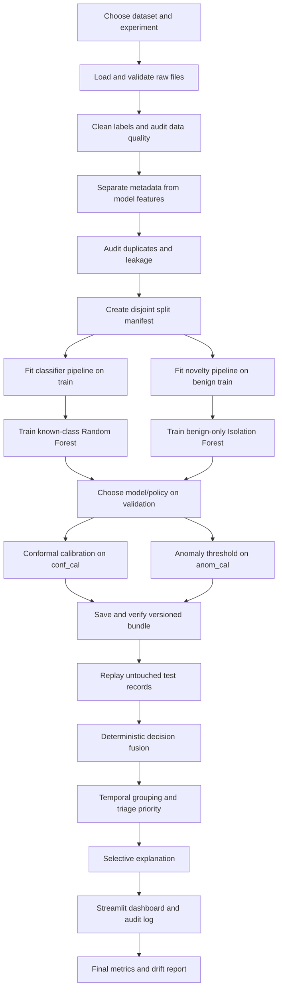

# Project Workflow

## 1. Objective

Build an offline open-world network intrusion detection demonstrator that can:

1. Recognize attack categories represented in its training data.
2. Flag behaviour that differs from the benign training baseline.
3. Avoid forcing ambiguous traffic into a known class.
4. Keep a visible warning when novelty and known-class predictions conflict.
5. Group related suspicious flows without hiding individual alerts.
6. Explain selected alerts and show what evidence was used.
7. Monitor distribution changes without automatically retraining.
8. Produce reproducible evaluation results for CIC-IDS2017 and NSL-KDD separately.

CIC-IDS2017 is the primary development path. NSL-KDD is a secondary benchmark with its own independent pipeline. The application replays public labelled data offline; it is not live network monitoring and does not establish real-world zero-day detection.

## 2. End-to-End Workflow

## 3. Phase-by-Phase Development

### Phase 1 — Repository and environment setup

Tasks:

- Create the Git repository and Python virtual environment.
- Add `requirements.txt` and pin tested package versions before the final run.
- Create folders for raw data, processed data, split manifests, artifacts, source code, tests, dashboard, and reports.
- Keep raw datasets read-only and record checksums.
- Add a README with dataset source/download notes, file layout, label mapping, and permitted offline use.
- Add configuration files for random seeds, dataset paths, selected feature set, split policy, and experiment ID.

**Deliverable:** reproducible project structure and working environment.

### Phase 2 — Dataset ingestion

**CIC-IDS2017**

- Load each selected CSV separately.
- Normalize column names and labels with deterministic mappings.
- Validate required columns and schema consistency before concatenation.
- Record source filename, source row number, checksum, row count, and class counts.
- Keep IPs, timestamps, ports, and Flow ID in metadata where useful.

**NSL-KDD**

- Load official train/test files using the documented schema.
- Assign the correct feature names and verify the field count.
- Retain original labels and create documented binary/family mappings.
- Exclude the target label and difficulty field from features.

**Deliverable:** two independent loaders and machine-readable validation reports.

### Phase 3 — Cleaning and leakage audit

For both datasets:

- Convert numeric columns safely and record conversion failures.
- Replace positive/negative infinity with missing values.
- Report missingness; do not silently replace invalid values with zero.
- Quarantine invalid/unmapped labels rather than silently treating them as benign.
- Audit exact duplicates, conflicting labels, and identical model-feature vectors across partitions.
- Separate identifiers and metadata from the model feature matrix.
- Review possible target-derived fields and collection artifacts.
- Keep raw data unchanged and retain row-level traceability.

CIC-specific:

- Exclude Flow ID, IP addresses, timestamps, source filename, and row identifiers from model features.
- Run an explicit Destination Port ablation as a separate experiment.
- Record day/source-file/attack-family composition to reveal possible collection-session confounding.

NSL-KDD-specific:

- Exclude target label and difficulty field.
- Encode protocol, service, and flag with train-fitted categorical handling.
- Define behaviour for categories not seen during training.

**Deliverable:** cleaned feature/metadata tables and a leakage-audit report.

### Phase 4 — Split and experiment design

Create five non-overlapping partitions for each experiment:

- `train`: fit classifier and permitted preprocessing; fit Isolation Forest on benign rows only.
- `validation`: compare models/settings, feature variants, priority weights, and display bands.
- `anom_cal`: benign-only records used to set the novelty threshold.
- `conf_cal`: labelled benign and known-attack records used for conformal quantiles.
- `test`: untouched final evaluation and replay.

Rules:

- `anom_cal` and `conf_cal` must be disjoint.
- The held-out LOFO attack family must be excluded from train, validation, and `conf_cal`.
- Do not use test labels or scores for model selection, threshold selection, or feature selection.
- Save record IDs, group IDs, class labels, random seed, and split method in a split manifest.

**CIC-IDS2017:** prefer capture-session/source-file-aware and time-aware grouping where feasible. Audit file/day/family overlap. If an independent time split cannot be built without losing required classes, state the limitation and avoid claiming temporal generalization.

**NSL-KDD:** preserve the official train/test split. Create train/validation/`anom_cal`/`conf_cal` only inside the official training portion. Report the benchmark independently.

**Deliverable:** reproducible split manifests and overlap checks.

### Phase 5 — Model training

**Model A: known-class classifier**

- Train a class-weighted `RandomForestClassifier` on benign plus known attack categories in `train`.
- Save the classifier preprocessor, class order, model settings, seed, and training metrics.
- Start with the baseline; add XGBoost only as a later comparison.

**Model B: novelty detector**

- Fit a separate novelty preprocessing path.
- Fit Isolation Forest on benign training rows only.
- Convert output into a consistent application-level anomaly score where higher means more unusual.
- Test score direction and save it with the model.

**Deliverable:** versioned models, preprocessing artifacts, training metrics, and class/schema contracts.

### Phase 6 — Calibration

**Anomaly threshold**

- Use only benign `anom_cal` records.
- Set a chosen benign FPR budget, for example 1%, using the documented finite-sample order-statistic rule.
- If the sample is too small to support the requested tail threshold, use the conservative no-trigger fallback and report the limitation.
- Save the threshold, score direction, sample count, target FPR, order-statistic index, and calibration score reference quantiles.

**Conformal quantiles**

- Use only known-class labelled records from `conf_cal`.
- Calculate class-specific finite-sample quantiles using the `(n_c + 1)` adjustment.
- Record per-class sample counts and the include-always fallback for classes with insufficient calibration support.

Do not reuse the same records for both calibration procedures. The nominal anomaly FPR/conformal coverage depends on exchangeability and may weaken under session dependence or distribution shift.

**Deliverable:** separate calibration artifacts and reports.

### Phase 7 — Decision fusion and inference contract

For every replayed flow:

1. Validate dataset ID, feature schema, feature order, dtypes, and model-bundle version.
2. Apply the correct dataset-specific classifier and novelty preprocessors.
3. Obtain classifier scores and the conformal prediction set.
4. Obtain the novelty score and compare it with the frozen anomaly threshold.
5. Apply the deterministic decision table below.
6. Calculate triage priority separately from the verdict.
7. Attach only available metadata and record model/version status.
8. Preserve raw signals, processing errors, and the final output object.

| Novelty gate | Conformal set | Output |
|---|---|---|
| Not triggered | Singleton known attack | `KNOWN_ATTACK` |
| Triggered | Singleton known attack | `KNOWN_ATTACK` plus visible novelty conflict and review requirement |
| Not triggered | `{BENIGN}` | `NORMAL` |
| Triggered | `{BENIGN}` | `UNKNOWN_ANOMALY` |
| Triggered | Empty or multiple classes | `UNKNOWN_ANOMALY` |
| Not triggered | Empty or multiple classes | `UNCERTAIN_REVIEW` |
| Any | Missing/invalid signal, schema mismatch, or model error | `PROCESSING_ERROR` / `DEGRADED_REVIEW`, never `NORMAL` |

A high anomaly score indicates unusual behaviour, not proof of an attack or confirmed zero-day. A held-out attack may resemble a known class; retain and report the novelty flag separately.

**Deliverable:** one stable, tested inference output object.

### Phase 8 — Temporal correlation

- Use only reliable dataset event timestamps and available host metadata.
- Process in event-time order and define handling for late/out-of-order records.
- Maintain a configurable rolling window, initially 30 seconds.
- Key the window by dataset, replay run, capture session, and source host where possible.
- Reset correlation state across unrelated capture sessions/days.
- Group repeated suspicious flows and increase triage priority where justified.
- Keep every individual flow alert visible; never silently discard isolated alerts.
- Disable unsupported grouping for datasets without reliable identifiers/timestamps. Do not invent NSL-KDD source IPs or event times.

**Deliverable:** tested incident-grouping component with before/after alert and recall metrics.

### Phase 9 — Explainability and analyst dashboard

Dashboard sections:

1. **Operations Monitor:** offline replay status, dataset/run ID, flow/verdict counts, anomaly threshold, and drift state.
2. **Alert Triage:** filters, priority, novelty flag, conformal set, model signals, metadata, correlation group, explanation, and feedback controls.
3. **Research & Evaluation:** known-class metrics, benign FPR, LOFO results, review burden, ablations, latency, and throughput.

For selected alerts:

- Show TreeSHAP results only for supported supervised tree predictions.
- Show baseline deviation separately from SHAP.
- Compare values with benign reference statistics.
- Explain verdict logic in plain language and show defensive investigation suggestions.
- Allow analyst feedback but do not modify a trained model or threshold automatically.

All screens must display that the data are offline dataset replay. The demonstration should run through the UI without requiring terminal interaction after startup.

**Deliverable:** usable Streamlit dashboard and audit log.

### Phase 10 — Drift, feedback, and artifact promotion

- Calculate PSI on batches against fixed training-baseline bins.
- Use smoothing for empty bins and a configurable minimum batch size.
- Show PSI as a distribution-shift warning, not attack evidence.
- Store analyst feedback separately from model training data.
- Require review/verification before feedback is considered for a future labelled dataset.
- Require a new split manifest, retraining/recalibration, final evaluation, and explicit promotion before replacing a model bundle.

**Deliverable:** drift report, feedback audit log, and documented model-promotion procedure.

## 4. Suggested Milestones

| Milestone | Completion condition |
|---|---|
| M1 — Data ready | Both loaders produce validation/provenance reports |
| M2 — Leakage-safe data | Feature contracts, duplicate audit, disjoint split manifests, and leakage checks pass |
| M3 — Baseline IDS | Class-weighted Random Forest trains and reports per-class metrics |
| M4 — Novelty gate | Benign-only Isolation Forest and finite-sample threshold work |
| M5 — Uncertainty layer | Class-conditional conformal sets and fallback handling work |
| M6 — Decision fusion | Every policy branch and fail-safe path passes unit tests |
| M7 — Dashboard | Held-out CSV replay produces visible flow alerts and incident groups |
| M8 — Research proof | LOFO, no-port ablation, FPR/review burden, latency, and leakage audits run |
| M9 — Secondary benchmark | Separate NSL-KDD results and limitations are reported |

## 5. Testing Checklist

### Data and leakage tests

- [ ] Raw input files are not modified.
- [ ] Label mapping never maps unknown labels to benign.
- [ ] Target labels, IDs, timestamps, filenames, row numbers, and NSL difficulty are excluded from model features.
- [ ] Invalid numeric values are reported and handled by fitted preprocessing.
- [ ] Duplicate/conflicting-label and feature-vector overlap reports are generated.
- [ ] Split manifests contain no forbidden row/group overlap.
- [ ] LOFO-held-out families are absent from train, validation, and conformal calibration.
- [ ] Test data never fit an encoder, imputer, scaler, feature selector, model, or threshold.

### Model and calibration tests

- [ ] Isolation Forest is fitted on benign training rows only.
- [ ] Larger application anomaly scores always mean more anomalous.
- [ ] Finite-sample threshold and insufficient-sample fallback are tested.
- [ ] `anom_cal` and `conf_cal` record IDs are disjoint.
- [ ] Conformal quantile uses the documented finite-sample index and class-specific counts.
- [ ] Class order is aligned with classifier score columns.
- [ ] Invalid/NaN/Infinity model outputs are rejected safely.

### Decision, dashboard, and operational tests

- [ ] Every row of the decision table has a unit test.
- [ ] Model/schema failure can never produce `NORMAL`.
- [ ] Novelty conflict remains visible when a singleton known attack set is returned.
- [ ] Correlation does not remove individual alerts.
- [ ] Missing timestamps/host IDs disable the relevant correlation dimension.
- [ ] Priority score never overrides the verdict and is labelled heuristic.
- [ ] SHAP and baseline deviations are correctly labelled.
- [ ] PSI uses fixed bins, smoothing, and minimum batch checks.
- [ ] Drift and unverified feedback never auto-retrain or change thresholds.
- [ ] UI clearly identifies offline dataset replay.

## 6. Definition of Done

The project is not complete merely because a model reports high accuracy. A complete demonstrator must reproduce its data cleaning and split manifests; show leakage checks; preserve independent train, validation, calibration, and test partitions; report known-attack performance and held-out-family novelty detection together with benign FPR and review burden; expose uncertain and degraded cases; keep all flow alerts visible after correlation; explain alerts without claiming causation; and report CIC-IDS2017 and NSL-KDD separately.

The final demo must replay dataset records through the UI without terminal interaction and must clearly state that the traffic is offline, dataset-based simulation rather than live network monitoring.
